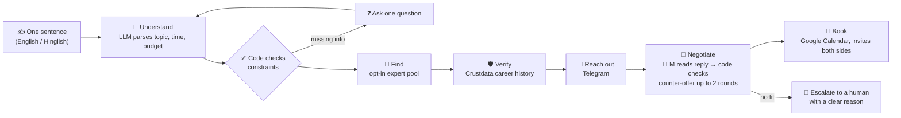

# 🧵 Sutradhar

### Type one sentence. Get a **verified** expert on your calendar.

> *"Kal shaam 6 se 8 ke beech warehouse wale kisi expert se 20 minute baat karni hai, 2k tak."*
>
> Sutradhar finds the expert, **fact-checks their résumé against Crustdata**, **negotiates the price on Telegram**,
> and **books the Google Calendar slot**. Every step is shown live, and code checks every decision the AI makes.

**ContextCon 04 · IIT Kanpur** · Team: **Aditya** (backend & agent) · **Sunil** (integrations, eval, onboarding) · **Deepak** (frontend)

[Try the public demo](https://sutradhar-kappa.vercel.app) to replay a sample booking. [Full-stack deployment guide](docs/DEPLOYMENT.md)

---

## 📊 The numbers (from our real eval, not mock data)

| | Result |
|---|---|
| 🧪 Eval runs | **60 / 60** (20 requests × 3 paraphrases each) |
| 🔁 Same outcome for every paraphrase of a request | **20 / 20** |
| 💰 Budget violations | **0** |
| ⏱ Time-window violations | **0** |
| 📅 Double bookings | **0** |
| 🕵️ Planted fake profiles caught | **4 / 4** |

<sub>Source: `backend/eval/latest.json` (run with Claude on the final negotiator code). Live on the **Eval** page of the app.</sub>

---

## 💡 What the agent does for you

Booking one expert call usually means days of searching, cold messages and back-and-forth on price.
Sutradhar's agent does all of it:

| You get | How the agent does it | What you see in the app |
|---|---|---|
| **Trust** | Every work-history claim is checked against Crustdata career data | 🟢 verified · 🟡 unverifiable · 🔴 contradicted, shown as **"Claimed vs Crustdata says"** with the source |
| **Speed** | Finds, ranks, messages and books on its own | Live stepper and an append-only agent log. In our local test: request to booked call in **13 s** |
| **Savings** | **Negotiator agent:** if an expert asks above budget, it counter-offers (up to 2 rounds) | **"₹400 saved by your agent · negotiated ₹2,400 → ₹2,000"** on the ticket |
| **Zero effort** | One sentence in. Asks one question only if something is missing | A booking ticket, a calendar invite for both sides, a downloadable receipt, and a chat with the booked expert |
| **A plan B** | If nobody fits, it says why and asks a human instead of guessing | "No service provider available" with the reason, or options to **Approve** |

---

## 🧠 How it works



### 🔒 The rule that keeps it safe: *the LLM proposes, code decides*
- **Claude only reads text:** the client's request becomes constraints, and an expert's reply ("7:15 for 1800", "saade saat baje, 1800 chalega") becomes a time and a price. It also drafts counter-offer messages.
- **Code makes every decision:** is the slot inside the window, is the price within budget, is a counter-offer allowed, who to contact next, when to book.
- The LLM can never override a hard constraint. That is why the eval shows **0 budget violations**.

### 💪 Built to not break
- **Crash-safe:** all state lives in SQLite and is saved *before* every side effect. Kill the server mid-run and it resumes where it stopped.
- **No double messages:** every Telegram send has an idempotency key (outbox table).
- **No double invites:** the calendar event ID is a hash of request + expert + slot.
- **No double bookings:** overlapping slots for the same expert are refused.
- **No AI key? Still works:** a rule-based parser keeps the pipeline running (simple English phrasing only).

---

## 🖥 A tour of the app

| Screen | What's there |
|---|---|
| **Sign in** | Two paths. *"I need an expert"* → **Continue with Google** (real OpenID Connect, ID token verified on the backend). *"I'm an expert"* → **Continue with LinkedIn** (real onboarding below). No typed or guest logins. |
| **Home** | What the agent does, and the live eval numbers |
| **New request** | Step-by-step: who, how long, **any date + custom time slot**, budget, notes, review. Plus one-click templates tested against the backend. |
| **Live request** ⭐ | Status stepper · constraints · shortlist with **Claimed vs Crustdata** per claim · agent log · booking ticket · **₹ saved** badge · receipt · **chat** (agent's Telegram messages, expert replies, and you can message the booked expert) |
| **My requests** | Needs your action · Pending · Scheduled (*Add to Google Calendar*, receipt) · History (last 10, *Book again*) |
| **Experts** | Opt-in pool with search and filters. Simulated profiles are labelled **Simulated**. |
| **Eval** | The report card above, read from `GET /eval/latest` |

### 🧑‍💼 Expert onboarding (identity binding)
Experts join through a separate server (`backend/integrations/onboarding.py`, port 8001):
1. **Sign in with LinkedIn** (OpenID Connect) proves they control that LinkedIn account.
2. **One-time Telegram deep link** proves the Telegram account belongs to the same person.
3. **Crustdata check:** the profile name must match the LinkedIn login. The current role becomes a verified claim.

---

## 🔍 Honest about the data

**Crustdata is used for one job: verifying people.** It does not know who consented, who is free tomorrow, or what anyone charges, and we don't pretend it does.

| Data | Source |
|---|---|
| Who is in the pool, rate, availability, Telegram | Opt-in onboarding (teammates and friends with real LinkedIn profiles) |
| Whether claimed work history is true | Crustdata career history, cached in `data/crustdata_cache/` so re-checks cost no credits |
| Extra profiles for variety | Real Crustdata profiles replayed by a simulator, labelled **Simulated** in the UI |
| Planted fakes (Test Profile A–D) | Real Crustdata records paired with inflated claims **written by our team** |

**The claims on Test Profile A–D were written by our team for testing. The real people behind those profiles never made these claims.**

More detail: [`docs/DATA_AND_LIMITATIONS.md`](docs/DATA_AND_LIMITATIONS.md)

---

## 🚀 Run it locally

**1. Backend** (port 8000, run from the repo root)
```bash
python -m venv .venv
source .venv/bin/activate          # Windows: .venv\Scripts\activate
pip install -r backend/requirements.txt
cp .env.example .env               # fill in the keys below
uvicorn backend.app.main:app --port 8000
```

**2. Frontend** (port 5173)
```bash
cd frontend
npm ci
cp .env.example .env               # VITE_MOCK=false to use the real backend
npm run dev                        # → http://localhost:5173
```
With `VITE_MOCK=true` the UI runs on `contract/fixtures/` only. No backend needed.

**3. Expert onboarding** (optional, port 8001)
```bash
python -m backend.integrations.onboarding
```

**Keys (`.env` at the repo root):** `ANTHROPIC_API_KEY` · `CRUSTDATA_API_KEY` · `TELEGRAM_BOT_TOKEN` · `GOOGLE_CALENDAR_ID`. For onboarding: `LINKEDIN_CLIENT_ID`, `LINKEDIN_CLIENT_SECRET`, `ONBOARDING_BOT_TOKEN`.
Google Calendar and Google sign-in use `credentials.json` (gitignored). Without it, a simulated calendar is used.

**Re-run the checks**
```bash
python -m backend.eval.run_eval              # 60-run eval → backend/eval/latest.json
python -m backend.eval.negotiation_check     # negotiator agent: accept / decline / escalate
```

---

## 🗂 Repo map

| Path | What | Owner |
|---|---|---|
| `contract/` | API contract, TypeScript types, fixtures. The single source of truth between frontend and backend. | Aditya |
| `backend/app/` | FastAPI, SQLite state machine, LLM intake and negotiation, calendar, Google sign-in | Aditya |
| `backend/integrations/` | Crustdata verification, Telegram, expert pool, LinkedIn onboarding | Sunil |
| `backend/eval/` | Eval harness and negotiation checks | Sunil |
| `frontend/` | React + TypeScript + Vite UI (no UI libraries, effects hand-written) | Deepak |
| `docs/` | Data & limitations, demo script | Aditya |

**Stack:** Python · FastAPI · SQLite · Claude (Anthropic) · Crustdata · Telegram Bot API · Google Calendar & OIDC · LinkedIn OIDC · React 19 · TypeScript · Vite

---

<p align="center"><b>Sutradhar</b>: the one who holds the strings, so you don't have to.</p>
